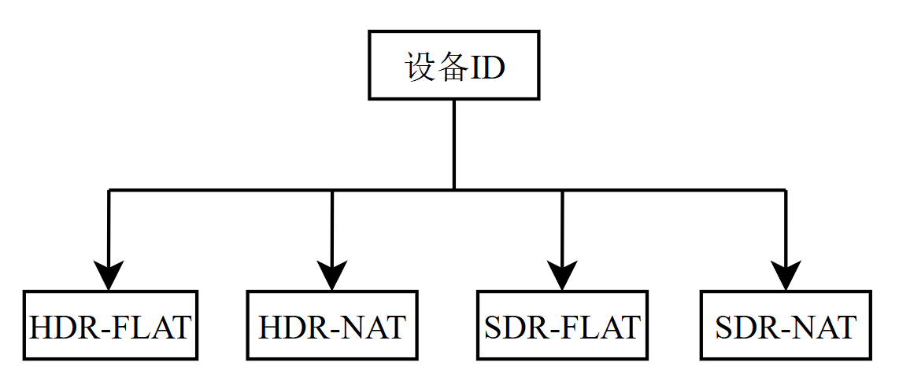

# HDRPlus
A Large Scale Dataset for Source Camera Identification of High Dynamic Range Image
A official public dataset for paper "HDRPlus: A Large Scale Dataset for Source Camera Identification of High Dynamic Range Image" 
## Background

Source camera identification aims to determine whether an image was captured by a specific physical device. Photo-Response Non-Uniformity (PRNU) provides a sensor-specific pattern for this task, and its use depends on the spatial correspondence between the reference fingerprint and the query-image noise residual. However, high dynamic range (HDR) imaging on smartphones often combines multiple exposures. The image alignment and processing involved can weaken the PRNU signal and affect this correspondence, making source camera identification more difficult. To support research on this problem, we introduce HDRPlus, a large-scale benchmark for PRNU-based source camera identification of HDR images. The dataset contains 15,477 images, including 7,596 HDR images and 7,881 standard dynamic range (SDR) images, collected from 30 smartphones across six brands: Apple, Huawei, Samsung, Xiaomi, LeEco, and OPPO. The devices were released between 2014 and 2025 and include both single-camera and multi-camera smartphones. Image resolutions range from 1840 × 3264 to 3468 × 4624 pixels. The dataset includes flat-content and natural-scene images captured under handheld conditions in both SDR and HDR modes. These images are organized into four categories: SDR-FLAT, HDR-FLAT, SDR-NAT, and HDR-NAT. The handheld natural HDR image counts range from 120 to 351 per device, providing more images per device for evaluation than the existing DHIF dataset. Device information, image counts, and recorded ISO and exposure-time ranges are provided in the supplementary tables. Image-level acquisition settings can also be inspected in the metadata of the corresponding original image files. In addition to collecting the dataset, we examine implementation details in the basic PRNU and HDR-PRNU methods, including Wiener filtering during reference-fingerprint extraction and query-residual extraction, as well as luminance weighting. Our experiments show that these choices can affect the reported performance and that their effects vary across devices. We therefore introduce a standardized benchmarking pipeline with clearly specified processing settings to support fair and reproducible comparisons. For each query image, the adaptive pipeline selects the larger PCE value produced by two processing branches, each using its own reference-fingerprint and query-residual settings. Experiments on HDRPlus and DHIF evaluate the effects of these implementation details and the performance of the proposed pipeline. The results highlight the challenges introduced by HDR capture and the importance of consistent evaluation settings when comparing PRNU-based methods.
  
## Dataset Structure

  
  

 

## Download 
-https://pan.baidu.com/s/1lBK3E65PmovJQh6xaXDYwA
- Extraction code:JJL6
  
## Conclusions

HDRPlus provides a large-scale benchmark for PRNU-based source camera identification of HDR images. It contains 15,477 SDR and HDR images from 30 smartphones, most of which feature multi-camera systems. Experiments show that subtle implementation differences can lead to substantial performance changes, with effects that vary across devices. The proposed standardized benchmarking pipeline supports fair, consistent, and reproducible comparisons of PRNU-based methods and is evaluated on both HDRPlus and DHIF. These findings highlight the importance of clearly specifying and controlling implementation details when evaluating source camera identification methods.
